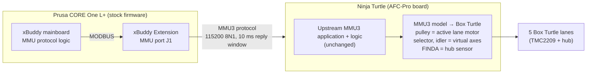

# Ninja Turtle

[](https://github.com/andrhamm/mmu-ninja-turtle/actions/workflows/ci.yml)
[](LICENSE.md)


> [!CAUTION]
> **Untested. This firmware has never run on a real printer, a real AFC-Pro board, or a real Box Turtle.**
> It builds and passes its tests in simulation only. Do not connect it to a printer you are not prepared to
> troubleshoot, and do not expect it to work yet. Hardware test reports are welcome — see
> [CONTRIBUTING.md](CONTRIBUTING.md).

**Run a Box Turtle filament changer on a stock Prusa printer — by teaching it to speak MMU3.**

Ninja Turtle is a fork of Prusa's open-source [MMU3 firmware](https://github.com/prusa3d/Prusa-Firmware-MMU) (v3.0.4)
retargeted to Armored Turtle's [Box Turtle](https://github.com/ArmoredTurtle/BoxTurtle) hardware. The printer keeps its
unmodified Prusa firmware — no Klipper — and sees an ordinary MMU3 on its MMU port: same protocol, same version handshake,
same error screens and Retry buttons. Behind that disguise, five Box Turtle lanes do the feeding.

> [!WARNING]
> This project connects third-party electronics to your printer's MMU port, which also carries 5 V and 24 V. Read
> [Wiring](#wiring) before connecting anything. Not affiliated with, endorsed by, or supported by Prusa Research or
> Armored Turtle. Use at your own risk.

## Status

| Area | State |
|---|---|
| MMU3 protocol, command logic, error handling | ✅ Upstream code, unchanged; 107 upstream unit tests pass |
| Closed-loop simulation (virtual printer ⇄ virtual MMU) | ✅ Tool changes, error → Retry recovery, 10 ms gate, 100-change soak |
| Box Turtle hardware model (host simulation) | ✅ Tool changes and recovery pass |
| AFC-Pro (STM32H723) firmware image | 🟡 Builds (~25 KB); lane routing, TMC2209 UART, USART link, EEPROM, watchdog written; **untested on hardware** |
| USB bridge for testing against a real printer (QT Py SAMD21) | 🟡 Builds; untested on hardware |
| Real printer + real Box Turtle | ⬜ Not started |

Target printer: **Prusa CORE One L / L+** (any Prusa printer that drives an MMU3 should behave the same at the protocol level;
only the CORE One L has been studied).

## How it works



The MMU3 firmware is cleanly layered (HAL → modules → logic). Ninja Turtle keeps the **logic and protocol untouched** and swaps
what sits underneath:

| MMU3 concept | Box Turtle realization |
|---|---|
| Pulley motor | Whichever lane motor is active (lane = the slot the idler has "engaged") |
| Selector, idler | Virtual axes: no hardware; homing end-stops are synthesized at the distances a real MMU3 would report |
| FINDA sensor | Box Turtle hub sensor |
| TMC2130 over SPI | TMC2209 over single-wire UART, one per lane |
| Cut command | Rejected (Box Turtle has no cutter at the changer) |

Because the printer runs the same protocol code it always does, the printer's MMU screens, filament-sensor handshakes,
spool join and recovery flows work as designed. The firmware cap of **5 filaments (T0–T4)** applies.

## Hardware

| Part | Notes |
|---|---|
| Prusa CORE One L / L+ | Stock firmware ≥ 6.5.3 (MMU3 support); developed against Buddy v6.10.1 sources |
| Box Turtle (4-lane kit) + parts for a 5th lane | e.g. [West3D kit](https://west3d.com/products/box-turtle-automated-filament-changer-multi-material-unit-by-armored-turtle) |
| Isik's Tech **AFC-Pro** controller (STM32H723) | [West3D](https://west3d.com/products/afc-pro-8-lane-box-turtle-multi-filament-controller-pcb); replaces the kit's AFC-Lite for 5+ lanes |
| 5× TMC2209 StepStick drivers | |
| 74AHCT125 buffer + 1 kΩ / 10 kΩ resistors | The printer's MMU RX input needs a **5 V** driver |
| CORE One MMU3 printer cable | Molex 2×6 to the extension board's MMU port |
| Optional: Adafruit QT Py SAMD21 | USB bridge for testing the firmware on a computer against the real printer |

### Wiring

Pinout source: Prusa's published xBuddy Extension schematic (Rev 06). Full details, sources and a pre-connection multimeter checklist live in
[`docs/afc-pro-port.md`](docs/afc-pro-port.md).

| MMU port J1 | Signal | Connect to |
|---|---|---|
| 1 | Printer TX (3.3 V) | 1 kΩ → controller RX (AFC-Pro PB7, switch port SW14) |
| 3 | Printer RX (needs 5 V drive) | 74AHCT125 output; input from controller TX (PB6, SW15); `/OE` from PG14 (SW20) with 10 kΩ pull-up to 5 V |
| 7, 9, 11 | GND | Controller GND |
| 2, 4, 5, 6, 8, 10, 12 | Internal bus, **5 V**, reset, power-loss, **24 V** | **Never connect** |

The firmware keeps the 5 V buffer disabled until the printer's TX line has idled high for 100 ms (printer powered).
Controller and printer share only ground and the two signals; each keeps its own power supply.

## Quick start (development)

Everything builds and runs in a dev container — the same one CI uses. You need Docker.

```bash
git clone https://github.com/andrhamm/mmu-ninja-turtle.git && cd mmu-ninja-turtle
scripts/dev ./scripts/ci        # build host tools + tests, run all tests, cross-build the AFC-Pro firmware
```

Run the closed loop yourself — Prusa's printer-side protocol code driving the virtual MMU through five tool changes:

```bash
scripts/dev tools/vprinter/loop_test.sh build/linux/tools/vmmu/vmmu build/linux/tools/vprinter/vprinter \
    --scenario tc:5 --gate-ms 10
```

```text
lineup ok: MMU 3.0.4 after 0 ms
T1 ok in 9643 ms
...
replies 5206  latency p50 0.11 ms  p99 1.08 ms  ...  link-faults 0
PASS
```

VS Code users can **Reopen in Container** (`.devcontainer/`). A native macOS build is possible with Homebrew GCC
(`cmake --preset macos`); see the [developer guide](docs/development.md).

## Testing

| Layer | What runs | Where |
|---|---|---|
| Upstream unit tests | 107 Catch2 tests of protocol, logic and modules | `ctest --preset linux` |
| Ninja Turtle unit tests | TMC2209 datagrams vs. Klipper reference vectors; flash EEPROM journal (incl. power loss mid-save) | `tests/unit/nt` |
| `vmmu` | Unmodified MMU application on the host with simulated motors/sensors, on a pty, serial device or TCP; fault injection | `tools/vmmu` |
| `vprinter` | Prusa Buddy's printer-side `ProtocolLogic` (vendored, v6.10.1) with a simulated printer filament sensor; emulates the CORE One extension board's 10 ms reply window | `tools/vprinter` |
| Closed loop | `vprinter` ⇄ `vmmu`: line-up, idle, tool changes, error → Retry, gate rejection; MMU3 model and `vmmu_bt` (built with the firmware's Box Turtle config) | `ctest -R loop` |
| Soak (manual) | 100 tool changes, 1 h idle | `ctest --preset linux -L soak` |

Testing against a real printer before any Box Turtle hardware exists: flash the QT Py bridge
(`tools/bridge/build.sh` → `.uf2`), wire it per the table above, expose it over TCP with `socat` on your computer, and point
`vmmu` at it (`--port tcp:host.docker.internal:5555`). The printer should report the MMU as connected.

## Building and flashing the AFC-Pro firmware

```bash
scripts/dev bash -c 'cmake -S ports/afcpro -B build/afcpro -G Ninja && cmake --build build/afcpro'
```

Flash with the STM32 ROM bootloader (hold **BOOT**, tap **RESET**, release **BOOT**), then on the host:

```bash
dfu-util -a 0 -s 0x08000000:leave -D build/afcpro/nt_afcpro.bin
```

This replaces any Klipper/Katapult image on the board; Klipper can be reflashed the same way.

## Repository layout

| Path | Contents |
|---|---|
| `src/` | Upstream MMU firmware + Ninja Turtle hooks (`src/nt/`, `src/hal/stm32/`, `src/pins_afcpro.h`) |
| `ports/afcpro/` | AFC-Pro (STM32H723) firmware: HAL implementation, lane driver, TMC2209 UART, startup, linker script |
| `tools/vmmu/`, `tools/vprinter/` | Host simulators and closed-loop test harness |
| `tools/bridge/` | QT Py SAMD21 USB ⇄ UART bridge |
| `tests/` | Upstream unit tests + `tests/unit/nt` |
| `third_party/` | Vendored Prusa Buddy subset (v6.10.1) and CMSIS (STM32H7) |
| `docs/` | [Developer guide](docs/development.md), [AFC-Pro port notes](docs/afc-pro-port.md), [upstream README](docs/upstream/PRUSA_README.md) |

## Roadmap

1. Measure the printer's MMU port; QT Py bridge + `vmmu` against the real printer (protocol line-up, idle soak, errors)
2. AFC-Pro bring-up: clocks, TMC2209 links, one lane, then five
3. Box Turtle calibration: steps/mm, currents, park/hub distances, bowden length
4. **Print-time lane assist:** a Box Turtle lane keeps its drive gears on the filament (an MMU3 idler releases it), so the
   extruder would otherwise drag filament through the lane gearbox. Drive the active lane from the TurtleNeck buffer
   sensors while the MMU is idle with filament in the nozzle, as AFC does — invisible to the printer
5. Lane sensors: empty-lane detection and auto-load on insertion; spool rewinders on unload
6. Multi-colour prints; long soak

## Known limitations

- Five filaments maximum (printer firmware accepts T0–T4 only).
- No cutter support; tip shaping comes from the slicer/printer as with a stock MMU3.
- Box Turtle per-lane sensors, rewinders and TurtleNeck buffer are mapped but not yet used by the logic. Until print-time
  lane assist exists, the extruder must pull filament through the active lane's drive gears.
- The printer may not accept a bowden length above 1000 mm (the MMU side now allows 2000 mm for Box Turtle installs).
- Hardware constants (lane steps/mm, motor current, sense resistor) are taken from AFC defaults and are unverified.

## Acknowledgements

- [Prusa Research](https://github.com/prusa3d) — MMU3 firmware and Buddy printer firmware (GPL-3.0); published electronics drawings
- [Armored Turtle](https://github.com/ArmoredTurtle) — Box Turtle and the AFC Klipper add-on (pin maps and lane defaults)
- [Isik's Tech](https://github.com/xbst/AFC-Pro) — AFC-Pro board and schematic
- [Klipper](https://github.com/Klipper3d/klipper) — TMC2209 UART reference implementation

## Contributing

See [CONTRIBUTING.md](CONTRIBUTING.md). The most valuable contribution right now is a hardware test report.

## License

GPL-3.0, inherited from Prusa-Firmware-MMU — see [`LICENSE.md`](LICENSE.md). Vendored third-party code keeps its own
license (`third_party/*/`). Prusa's graphics assets remain CC BY-NC-SA as described in the
[upstream README](docs/upstream/PRUSA_README.md).
